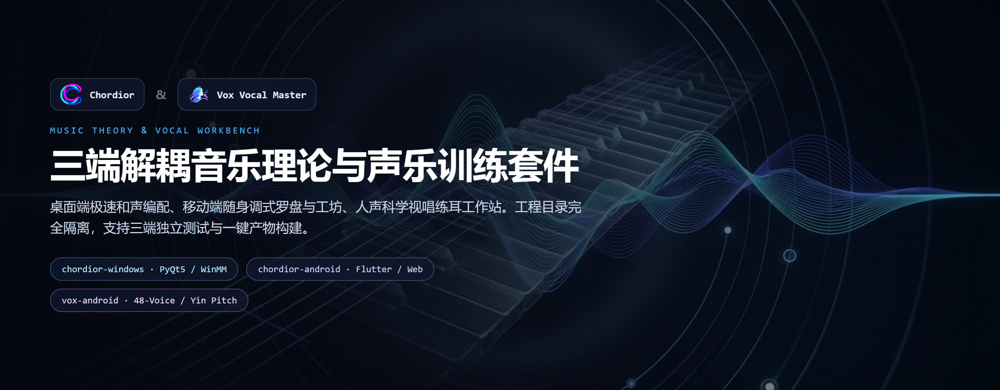
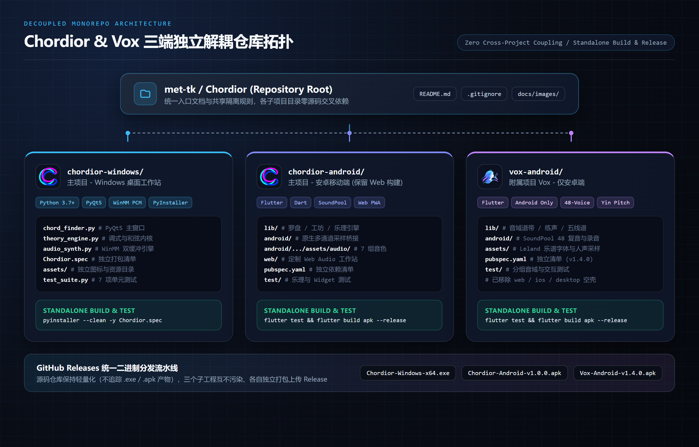
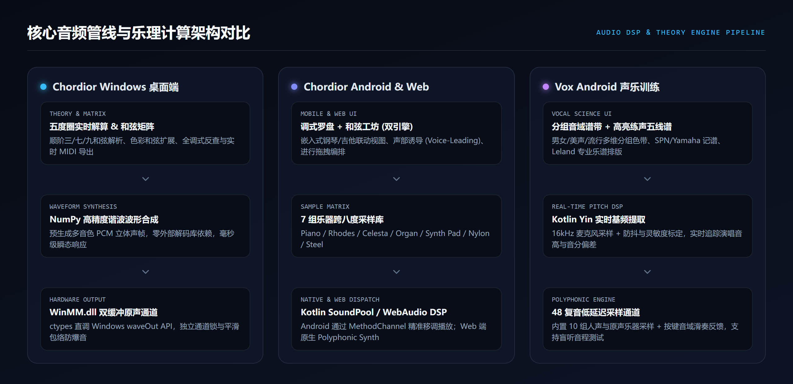
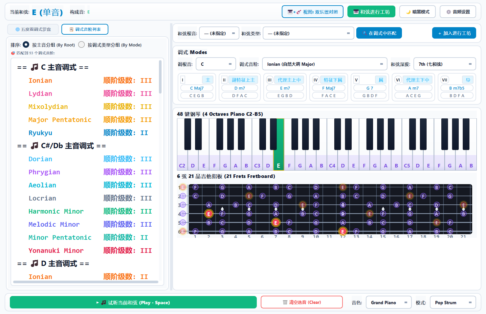

# Chordior & Vox 音乐理论与声乐训练套件

> **AI-driven by: taketo**  
> 本项目已重构为三端完全解耦的独立子工程结构：主项目 **Chordior (Windows 桌面端 / Android 与 Web 端)** 与附属项目 **Vox (仅 Android 声乐训练端)** 各自拥有独立的依赖、构建清单与测试体系，互不污染、均可单目录构建发布。



---

## 仓库目录拓扑与解耦设计



```text
Chordior/
├── chordior-windows/     # 主项目 - Windows 桌面工作站 (Python 3.7+ / PyQt5 / WinMM PCM / PyInstaller)
├── chordior-android/     # 主项目 - Android 移动端与定制 Web PWA (Flutter / Kotlin SoundPool & AudioTrack)
├── vox-android/          # 附属项目 Vox - 仅 Android 声乐音域与视唱练耳 (Flutter / 48 复音 / Yin 基频提取)
├── docs/
│   └── images/           # 仓库文档架构图、波形管线图与桌面端预览图
└── README.md             # 根仓库总览文档
```

---

## 子工程总览矩阵

| 子工程目录 | 项目归属 | 目标平台 | 核心技术栈 | 独立构建入口 | 详细文档 |
| :--- | :--- | :--- | :--- | :--- | :--- |
| [`chordior-windows/`](./chordior-windows/README.md) | 主项目 Chordior | Windows 桌面端 | Python 3.7+ · PyQt5 · NumPy · WinMM.dll (`ctypes`) · PyInstaller | `pyinstaller --clean -y Chordior.spec` | [Windows 端文档](./chordior-windows/README.md) |
| [`chordior-android/`](./chordior-android/README.md) | 主项目 Chordior | Android (保留 `web/` 构建) | Flutter · Dart · Provider · Kotlin SoundPool · WebAudio | `flutter build apk --release` | [Android 端文档](./chordior-android/README.md) |
| [`vox-android/`](./vox-android/README.md) | 附属项目 Vox (`v1.4.0`) | 仅 Android | Flutter · Dart · 48 复音采样引擎 · Yin 实时音高识别 | `flutter build apk --release` | [Vox 专项文档](./vox-android/README.md) |

---

## 核心音频管线与乐理架构



---

## 实机界面预览

### 1. Chordior Windows 桌面端工作台



<details>
<summary>查看更多历史实机运行截图 (Windows 深色主题与和弦/指板视图)</summary>

<p align="center">
  
</p>
<p align="center">
  
</p>

</details>

### 2. Chordior Android 移动端

<p align="center">
  
</p>

### 3. Vox Android 声乐训练端

详见 [`vox-android/README.md`](./vox-android/README.md)：集成多组男声/女声/美声/流行人声音域色带、SPN 与 Yamaha 记谱切换、`Leland.otf` 专业五线谱渲染、16kHz Yin 实时麦克风基频提取及 48 复音低延迟交互钢琴。

---

## 独立构建与测试指南

各子工程均保持零交叉目录源码引用，可分别进入对应目录独立开发、运行测试与打包发布物：

```bash
# 1. Chordior Windows 桌面端测试与单文件打包 (Windows)
cd chordior-windows
pip install -r requirements.txt
python -m unittest test_suite.py
pyinstaller --clean -y Chordior.spec
# 输出产物: chordior-windows/dist/Chordior.exe

# 2. Chordior Android 端测试与 APK 构建
cd chordior-android
flutter pub get && flutter analyze && flutter test
flutter build apk --release
# 输出产物: chordior-android/build/app/outputs/flutter-apk/app-release.apk

# 3. Vox Android 端测试与 APK 构建
cd vox-android
flutter pub get && flutter analyze && flutter test
flutter build apk --release
# 输出产物: vox-android/build/app/outputs/flutter-apk/app-release.apk
```

---

## 二进制发布说明 (GitHub Releases)

为保持 Git 源码仓库轻量化，`.exe`、`.apk` 等二进制编译产物与临时音频缓存文件已从版本库移出并通过 `.gitignore` 屏蔽。请前往本仓库的 **GitHub Releases** 页面下载对应平台最新安装包：

- **Windows 桌面版**：`Chordior-Windows-x64.exe`
- **Chordior Android 版**：`Chordior-Android-v1.0.0.apk`
- **Vox 声乐训练 Android 版**：`Vox-Android-v1.4.0.apk`
