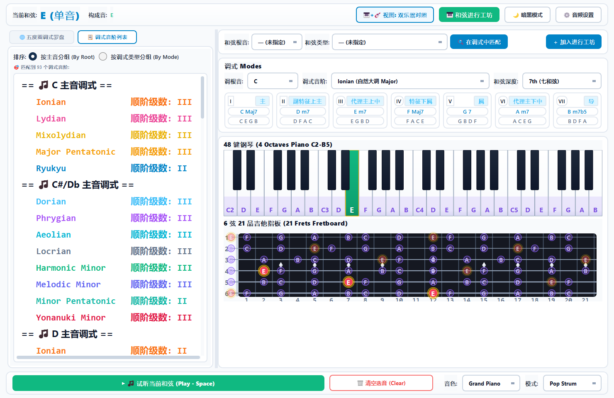

# Chordior Windows 桌面工作站 (`chordior-windows`)

<p align="left">
  
</p>

Chordior 主项目的 Windows 桌面端实现，基于 **Python 3.7+ / PyQt5 / NumPy / Windows WinMM API** 构建，提供极低延迟波形合成发声与实时音乐理论交互面板，可通过 **PyInstaller** 独立打包为单文件 `.exe` 可执行程序。

返回总览：[仓库根 README](../README.md) | 查看 [架构拓扑图](../docs/images/architecture-topology.png)

---

## 界面预览



---

## 核心特性

1. **五度圈与调式罗盘**
   - `circle_of_fifths.py` 提供交互式五度圈选调与色彩联动。
   - `theory_engine.py`、`chord.py`、`additions.py` 实时反查音符集合对应的和弦名称、转位、顺阶级数与色彩扩展，并枚举匹配调式音阶（按主音或按调式类型分组）。
2. **双乐器联动与视听一体**
   - `piano_widget.py`：4 八度全域钢琴键盘（`C2-B5`），支持键盘点击试音与复音勾选。
   - `guitar_widget.py`：6 弦 21 品标准吉他指板，实时高亮调式音级、和弦根音与各把位分布。
3. **和弦进行工坊与和声矩阵**
   - `progression_studio.py`：支持编排和弦进行序列、声部平滑连接并导出标准 `.mid` 文件（由 `midi_utils.py` 负责 MIDI 编码）。
   - `harmonic_matrix.py` 与 `harmonic_advice.py`：辅助分析功能进行走向与和弦替代建议。
4. **零依赖 WinMM 原生音频合成引擎**
   - `audio_synth.py` 通过 `NumPy` 预先合成多乐器谐波波形帧，并经由 `ctypes.windll.winmm` 直调 Windows `waveOut` 双缓冲原生通道输出，无需外部 SDL/Pygame 运行时，兼顾多种演奏模式（齐奏、`Pop Strum` 扫弦、上行/下行琶音）。
5. **明暗主题与自定义外观**
   - `styles.py`、`color_picker_dialog.py`、`presets_dialog.py`、`audio_settings_dialog.py` 支持浅色/深色工作区切换（由 `QSettings("TaketoAudio", "Chordior")` 持久化配置）与多音色包络设置。

---

## 目录结构

```text
chordior-windows/
├── chord_finder.py          # 应用主入口与 ChordStudioMainWindow 主窗口
├── theory_engine.py         # 核心乐理计算、调式识别与顺阶和弦推导
├── audio_synth.py           # NumPy 波形合成与 WinMM 立体声通道输出引擎
├── midi_utils.py            # 标准 MIDI 文件读写工具
├── progression_studio.py    # 和弦进行工坊界面与逻辑
├── harmonic_matrix.py       # 和声矩阵分析视图
├── harmonic_advice.py       # 和声进行建议模块
├── circle_of_fifths.py      # 交互式五度圈组件
├── piano_widget.py          # 48 键钢琴键盘交互控件
├── guitar_widget.py         # 6 弦 21 品吉他指板控件
├── presets_dialog.py        # 预设管理对话框
├── audio_settings_dialog.py # 音频设置对话框
├── color_picker_dialog.py   # 自定义调色板对话框
├── styles.py                # 主题 QSS 与颜色表定义
├── chord.py                 # 和弦数据结构扩展
├── additions.py             # 和弦延伸音与色彩扩展定义
├── test_suite.py            # 单元测试集 (unittest)
├── Chordior.spec            # PyInstaller 单文件构建规范
├── requirements.txt         # 独立 Python 依赖清单
└── assets/                  # 程序图标与图像资源
    ├── app_icon.ico
    ├── app_icon_hd.ico
    ├── icon_saishuu.png
    └── 钢琴.ico
```

---

## 环境安装、运行与独立打包

> 环境建议：Windows 10/11 + **Python 3.7 - 3.11**（已实测通过：**Python 3.7.3 + PyQt5 5.15.10 + PyInstaller 5.13.2**）。

### 1. 安装依赖并源码运行

```bash
cd chordior-windows
pip install -r requirements.txt
python chord_finder.py
```

### 2. 运行单元测试

```bash
cd chordior-windows
python -m unittest test_suite.py
```

### 3. 打包单文件 `.exe`

```bash
cd chordior-windows
pip install pyinstaller>=5.13.0
pyinstaller --clean -y Chordior.spec
```

构建完成后，独立单文件可执行程序位于 `chordior-windows/dist/Chordior.exe`。
